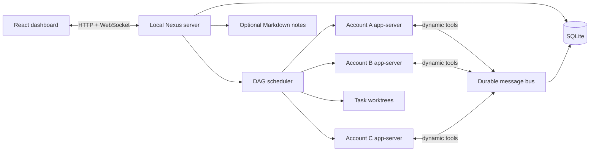

# Architecture

The dashboard and API run in one local Node process. Every real account owns a separate official Codex app-server process over stdio. A logical worker normally owns one resumable provider thread; usage handoff keeps the worker identity but creates a fresh thread under the destination account. Worker-level children get separate threads and worktrees; native research children are runtime-managed and communicate externally through their parent.

Normal launches use the live installation, with no seeded data or mock execution. Optional scripted testing requires `npm run mock:desktop`, uses a different database and app instance, and is visibly labeled. Opening a project creates no agents or tasks; the user's first prompt starts planning. Persisted projects restart paused, so account reauthentication cannot silently resume queued work. Native executable discovery and login errors surface in account setup.

## Data and transactions

SQLite WAL stores versioned JSON records behind a typed store boundary. The initial migration establishes records, migration metadata and message deduplication. Message plus delivery creation is atomic. Plans and nested delegation are atomic to avoid orphaned workers when validation fails. Store changes are debounced into live snapshots. A future relational/PostgreSQL adapter must preserve transaction and uniqueness behavior; no PostgreSQL implementation is claimed.

## Scheduling and lineage

The coordinator submits a bounded DAG; cycle, missing-key, provider and account validation happen before mutation. Every task belongs to a project/repository and one worker. Every child inherits account, project and filesystem permission class. Depth and pool limits include recursive descendants. The scheduler reserves capacity before asynchronous startup, so multiple ticks cannot oversubscribe work. Native read-only sessions reserve their whole potential native-child budget. File-scope conflicts serialize tasks on the same repository even across different projects.

Failed/interrupted tasks remain inspectable; the user can resume them. Dependencies remain blocked until prerequisites finish successfully. Projects can pause scheduling and interrupt work. Five minutes without runtime events generates a stalled event, not an unsafe automatic rerun. This protects against duplicating a still-running side effect.

## Communication

The message envelope records sender, recipient, project, repository, task, type, timestamp, correlation ID, payload and deduplication key. A separate durable delivery record distinguishes queued, delivered, acknowledged and expired states. Delivery uses exponential backoff capped at 60 seconds and a 24-hour TTL. Acknowledgment is recipient-bound. Replays may occur: consumers must use message IDs/deduplication keys, not assume exactly-once processing.

An active worker receives supported `turn/steer` input. Failed/no-active-turn delivery stays queued. A blocked worker is scheduled again when it has a message, and its next turn includes its inbox. A parent cannot finalize successfully while child work or unread child results remain. Already completed unrelated workers are not spontaneously reactivated by arbitrary messages. Native child requests are not impersonated as the parent; unsupported direct access fails and the parent is instructed to bridge communication.

## Git integration

Every coding worker gets `nexus/<task UUID>` and a separate worktree based on repository HEAD. Dependent artifacts are referenced, not silently applied. Change inspection precedes user-requested local commits. Draft-PR creation requires an approval record and uses argument arrays plus a body file. GitHub operations use the user's existing GitHub CLI identity. Default branches are never merged or force-pushed by Nexus.

## Images and usage checkpoints

Authenticated attachment routes store PNG/JPEG/WebP bytes separately from SQLite metadata and WebSocket snapshots. Attachment IDs are scoped to a project and chat. Chat and steering requests turn those IDs into official Codex `localImage` inputs; previews use authenticated blob fetches.

The scheduler observes provider usage windows and usage-limit errors. At the 95% reserve it requests interruption, waits for turn completion, and saves a Git snapshot with an alternate index and private ref. Public conversation, task reports, messages, and attachment references go to a local context manifest. The logical worker and task keep their identity, worktree and dependencies; an eligible alternate account starts a new thread with that context. Approval restrictions cannot become more permissive. Source token baselines are not reused by the destination. With no eligible alternate, fresh provider capacity is polled once a minute. Manual pause, Stop, restart holds, account drain and concurrency limits remain effective. Recovery never publishes to GitHub or transfers sign-in credentials.

## Runtime version boundary

The current implementation was verified using generated schemas from `codex app-server generate-ts --experimental`. Its dynamic tool specification uses tagged `type: function` entries, with host `item/tool/call` replies containing `inputText` items and a success flag. Dynamic tools are experimental. The runtime probe creates ephemeral threads without spending inference usage. No undocumented token extraction or auth endpoints are used.

Authentication, model access, sandbox support, login callbacks, actual model tool usage and native children require authenticated integration tests. Catalog discovery is deliberately not presented as a capability guarantee.
